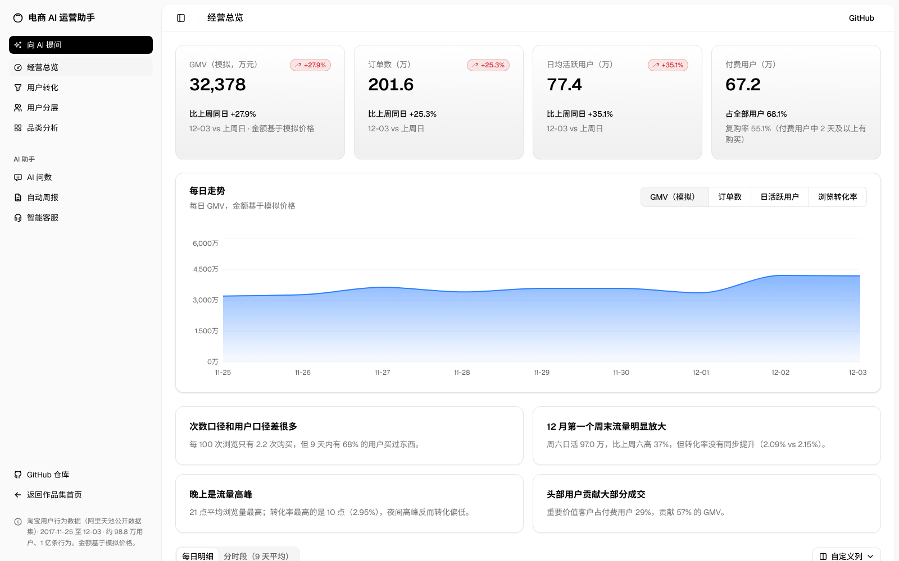
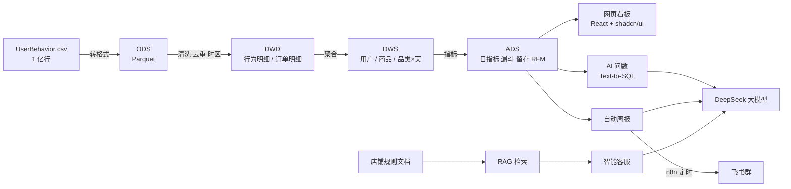

# 电商 AI 运营助手

[](https://github.com/Lt0226-Win/ecom-ai-assistant/actions/workflows/tests.yml)

**一句话：基于 1 亿条淘宝用户行为数据搭建数据仓库和经营看板，再用大模型把“查数据、写周报、答客服”这三件重复工作自动化。**

**在线体验：[ltfolio.cn/demo](https://ltfolio.cn/demo/)**（AI 功能每天限 100 次调用）　|　作品集：[ltfolio.cn](https://ltfolio.cn)



## 解决什么问题

电商运营每天要面对三类问题：

1. **看不清**：用户在哪一步流失？谁是核心用户？哪些品类值得优化？原始日志有 1 亿行，没法直接看。
2. **查数慢**：每个临时问题都要找数据同学写 SQL，来回沟通一次就是半天。
3. **重复劳动多**：每周手写经营周报；客服反复回答“退款多久到账”这类有标准答案的问题。

本项目的做法：先把原始数据清洗成分层数仓、做成看板回答第 1 类问题；再用大模型做 AI 问数、自动周报、智能客服，解决第 2、3 类问题。所有 AI 功能都带“防出错”的设计（SQL 只读检查、周报数字自动核对、客服查不到就转人工），并有离线评测集量化效果。

## 四个功能

### 1. 经营分析看板

- 网页看板基于 shadcn/ui 官方 `dashboard-01` 模板，包含**经营总览、用户转化、用户分层（RFM）、品类分析** 4 个分析页，以及下面 3 个 AI 功能页。
- 数据来自 DuckDB 数仓：3.5GB CSV → ODS / DWD / DWS / ADS 四层，16 项数据质量自动检查，1 亿行全量构建约 30 秒。
- 典型结论：9 天内 61% 的浏览用户完成购买，但每 100 次浏览只有 2.2 次购买；重要价值客户占付费用户 28.7%，贡献 56.9% 的 GMV。完整结论见 [分析报告](docs/analysis_report.md)。

### 2. AI 问数（Text-to-SQL）

- 用中文提问 → 大模型根据语义层说明写 SQL → **只读安全检查后执行** → 报错时把错误发回模型自动修正（最多重试 2 次）→ 用中文总结结论。
- 安全措施：只放行单条 `SELECT` / `WITH` 查询，只读连接，查询超时自动中断，最多返回 500 行。
- 效果：开发集 23 道题准确率 95.7%；另有 10 道未参与调优的独立题 10/10（样本较小，仅作初步验证）。见 [开发集报告](reports/text2sql_eval.md)、[独立题报告](reports/text2sql_holdout.md)。

### 3. 自动周报

- **SQL 负责算数，大模型只负责写分析**，生成后自动把文中每个数字和 SQL 结果比对，对不上的标出来，防止模型编数字。
- 可推送到飞书群；`workflows/` 里的 n8n 工作流可每周定时触发；没有 API Key 或调用失败时退回模板生成。
- 效果：随机篡改数字 500 次拦下 88.2%；在真实的大模型周报里拦住了 2 处金额单位错误（差 10 倍）。见 [核对演示](reports/weekly/guard_demo.md)、[人工复核](reports/weekly/review_notes.md)。

### 4. 智能客服

- **规则问答（RAG）**：基于店铺规则文档（`kb/docs/`）检索后回答，标注引用来源；知识库里查不到就提示转人工。检索默认用 BM25，配置向量模型后自动切换为“关键词 + 向量”混合检索（RRF 融合）。
- **工单分类**：把顾客消息分到物流查询、退换货、退款进度、商品质量、发票、优惠价保、账户支付、其他咨询 8 类，同时给出紧急程度、情绪和摘要；提供规则法和大模型法两种方式对比。
- 效果：检索 Hit@3 100%，拒答判断 100%（23 题）。见 [评测报告](reports/service_eval.md)。

## 技术栈

| 方向 | 技术 |
|---|---|
| 数据 | DuckDB、SQL（窗口函数、CTE、FILTER 聚合）、Parquet、pandas |
| 前端看板 | React 19、Vite、shadcn/ui（dashboard-01）、Tailwind CSS 4、Recharts |
| 后端接口 | FastAPI、uvicorn |
| AI | DeepSeek（OpenAI 兼容接口）、Text-to-SQL、RAG（rank-bm25 / 可选 BAAI/bge-m3 向量检索）、结构化 JSON 输出 |
| 自动化 | n8n 定时工作流、飞书群机器人 |
| 工程 | pytest + GitHub Actions、合成数据测试、离线评测集、依赖版本锁定 |



## 数据说明

- 来源：[阿里天池 · 淘宝用户购物行为数据集](https://tianchi.aliyun.com/dataset/649)，2017-11-25 至 12-03，约 98.8 万用户、1 亿条行为（浏览、加购、收藏、购买）。
- **原始数据没有价格**，项目给每个商品生成了可复现的**模拟价格**（规则见 `sql/02_dim_item.sql`），金额类指标仅用于演示分析方法。
- 客服知识库和 60 条工单是为演示编写的**虚构店铺规则和模拟工单**。

## 如何本地运行

**环境要求**：Python 3.12；修改前端页面才需要 Node 20+（构建好的网页 `web/dist` 已提交，只运行不需要装 Node）。

### 方式一：Mac 双击运行

1. 从天池下载数据集，把 `UserBehavior.csv` 放到 `data/raw/`
2. 双击 `安装.command`：创建虚拟环境、安装依赖、生成 `.env`、构建数据仓库（约 1 分钟）
3. 打开项目根目录的 `.env`，填写 `DEEPSEEK_API_KEY`（不填也能看分析看板，AI 页面为演示模式）
4. 双击 `启动看板.command`，浏览器自动打开 http://localhost:8600

### 方式二：命令行

```bash
python3 -m venv .venv && source .venv/bin/activate
pip install -r requirements.txt
cp .env.example .env                  # 填写 DEEPSEEK_API_KEY，其他配置项都是选填
python pipeline/build_warehouse.py    # 构建数据仓库 + 16 项质量检查
uvicorn api.web:app --port 8600       # 启动看板（网页 + 接口），打开 http://localhost:8600
```

`.env` 主要配置项（完整说明见 `.env.example`）：

| 配置 | 作用 |
|---|---|
| `DEEPSEEK_API_KEY` | 大模型密钥，AI 问数 / 周报 / 客服需要 |
| `FEISHU_WEBHOOK` | 飞书群机器人地址，推送周报用（选填） |
| `EMBEDDING_API_KEY` | 向量模型密钥，填了客服改用混合检索（选填） |
| `DUCKDB_MEMORY_LIMIT` | DuckDB 可用内存，默认 4GB，内存小可调低 |
| `API_TOKEN` | 给 n8n / Dify 用的接口口令（选填，建议设置） |

### 其他常用命令

```bash
python ai/weekly_report.py --push              # 生成周报并推送飞书
python eval/run_text2sql_eval.py               # AI 问数评测（23 道开发集）
python eval/run_text2sql_eval.py --holdout     # AI 问数独立题评测（10 道）
python eval/run_service_eval.py --llm          # 智能客服评测
python eval/run_weekly_guard_demo.py --reuse   # 周报数字核对演示（随机篡改 500 次）
uvicorn api.server:app --port 8000             # 给 n8n / Dify 调用的接口，默认只允许本机访问
pip install -r requirements-dev.txt && pytest  # 运行全部测试（自动生成合成数据，不需要下载原始数据）
```

修改前端页面：

```bash
cd web && npm install --legacy-peer-deps && npm run dev   # 开发预览
npm run build                                             # 重新生成 web/dist
```

## 目录结构

```
├── pipeline/   数据流水线：构建数仓、质量检查、生成演示库
├── sql/        分层建表 SQL（01 DWD → 05 ADS）
├── web/        网页看板（React + shadcn/ui，源码在 src/，构建产物 dist/ 已提交）
├── api/        FastAPI：web.py 给网页看板，server.py 给 n8n / Dify
├── ai/         AI 能力：llm、text2sql、weekly_report、rag、tickets
├── kb/         客服知识库文档 + 模拟工单
├── eval/       评测集与评测脚本
├── tests/      自动化测试（pytest，GitHub Actions 自动运行）
├── workflows/  n8n 工作流（可直接导入）
├── deploy/     在线演示的服务器部署脚本
├── reports/    数据质量、评测报告、周报样例
└── docs/       分析报告、Dify 搭建说明等文档
```
